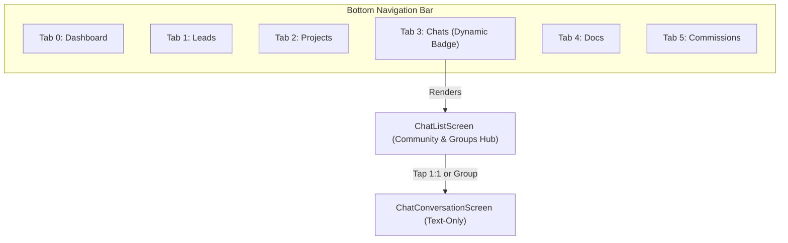

# Implementation Plan: Move CP Chat to Bottom Navigation Bar & Remove from Top Row

> **Document Version:** 1.0.0  
> **Target Module:** Navigation Architecture (`lib/features/home/main_navigation_shell.dart`, `lib/features/dashboard/dashboard_screen.dart`)  
> **Status:** Ready for Review & Approval  
> **Core Requirement:** 
> 1. Remove the chat icon from the Dashboard top row (App Bar).
> 2. Embed the CP Chat & Community system directly as a primary Tab in the Bottom Navigation Bar (`BottomNavigationBar`).

---

## 1. Overview & Objective

Previously, the CP Chat system was accessed via a top-bar action button in the Dashboard and a dedicated Dashboard card. The requirement is now to elevate **CP Community & Chats** into the **core bottom navigation system** (Tabs) alongside Dashboard, Leads, Projects, Docs, and Commissions, while decluttering the top row.

---

## 2. Before vs. After Architecture

### Top Row (App Bar):
- **Before:** `Briefcase` + `CP CRM` | `SYNCED` | `Moon (Theme)` | `Bell (Notifs)` | **`Chat (Forum icon)`** | `Avatar`
- **After:** `Briefcase` + `CP CRM` | `SYNCED` | `Moon (Theme)` | `Bell (Notifs)` | `Avatar` *(Decluttered top bar)*

### Bottom Navigation Bar (Tabs):



| Index | Tab Label | Active Icon | Inactive Icon | Dynamic Badge |
| :---: | :--- | :--- | :--- | :--- |
| **0** | **Dashboard** | `Icons.home_rounded` | `Icons.grid_view_outlined` | None |
| **1** | **Leads** | `Icons.people_alt_rounded` | `Icons.people_alt_outlined` | `leads.length` |
| **2** | **Projects** | `Icons.apartment_rounded` | `Icons.apartment_outlined` | None |
| **3** | **Chats** *(New)* | `Icons.forum_rounded` | `Icons.forum_outlined` | `totalUnreadChatCount` |
| **4** | **Docs** | `Icons.folder_shared_rounded` | `Icons.folder_shared_outlined` | `missingMandatoryDocsCount` |
| **5** | **Commissions** | `Icons.account_balance_wallet_rounded` | `Icons.account_balance_wallet_outlined` | None |

---

## 3. Detailed Changes by File

### 1. `lib/features/dashboard/dashboard_screen.dart`
1. **Remove Top Row Chat Button:**
   - Remove the `IconButton` with `Icons.forum_outlined` and its `Badge` from `_buildTopBar`.
   - The top row now strictly contains: Brand & Subtitle, `SYNCED` status pill, Dark mode toggle, Notifications Bell, and User Avatar.
2. **Update Dashboard Community Card Action:**
   - Update the "Open Chats" button in `_buildCpCommunityCard` to trigger tab switch to Index 3:
     ```dart
     onNavigateTab(3);
     ```

### 2. `lib/features/home/main_navigation_shell.dart`
1. **Update `screens` List in `IndexedStack`:**
   - Insert `ChatListScreen(state: widget.state)` at index 3:
     - Index 0: `DashboardScreen`
     - Index 1: `LeadsScreen`
     - Index 2: `ProjectsScreen`
     - **Index 3: `ChatListScreen`**
     - Index 4: `DocsScreen`
     - Index 5: `CommissionsScreen`
2. **Update Dashboard Screen Tab Callbacks:**
   - `onOpenDocs`: Switch to index 4 (`_currentIndex = 4`, `_docsInitialTab = 0`).
   - `onOpenInvoices`: Switch to index 4 (`_currentIndex = 4`, `_docsInitialTab = 1`).
   - `onOpenCommissions`: Switch to index 5 (`_currentIndex = 5`).
   - `onOpenChats`: Switch to index 3 (`_currentIndex = 3`).
3. **Add Bottom Nav Item:**
   - Add the 6th navigation item at index 3:
     ```dart
     _buildBottomNavItem(
       index: 3,
       label: 'Chats',
       activeIcon: Icons.forum_rounded,
       inactiveIcon: Icons.forum_outlined,
       badgeCount: widget.state.totalUnreadChatCount > 0 ? widget.state.totalUnreadChatCount : null,
       isDark: isDark,
     ),
     ```
4. **Responsive Sizing & Label Formatting:**
   - Set font size for bottom navigation labels to `10.5` (or `10` when unselected, `11` when selected) to ensure that all 6 tabs fit cleanly without wrapping or overflow on narrow mobile screens.

---

## 4. Strict "No-Call" Policy Continuity

All existing privacy and security guardrails remain intact:
- No phone/call/videocam icons anywhere in `ChatListScreen`, `ChatConversationScreen`, or `GroupInfoSheet`.
- Phone numbers remain masked or omitted.
- No `tel:` dialer links.

---

## 5. Verification & Testing

1. **Automated Unit & Widget Tests:**
   - Update any tests that verify tab indices in `MainNavigationShell`.
   - Add widget test in `test/cp_chat_and_group_messaging_test.dart` asserting:
     - `DashboardScreen` top bar does NOT contain `Icons.forum_outlined`.
     - `MainNavigationShell` renders the 'Chats' bottom nav item with icon and badge.
     - Tapping the 'Chats' bottom nav item displays `ChatListScreen`.
2. **Full Regression Test:**
   - Run `flutter test` to ensure all 98 existing tests continue to pass with 0 regressions.
