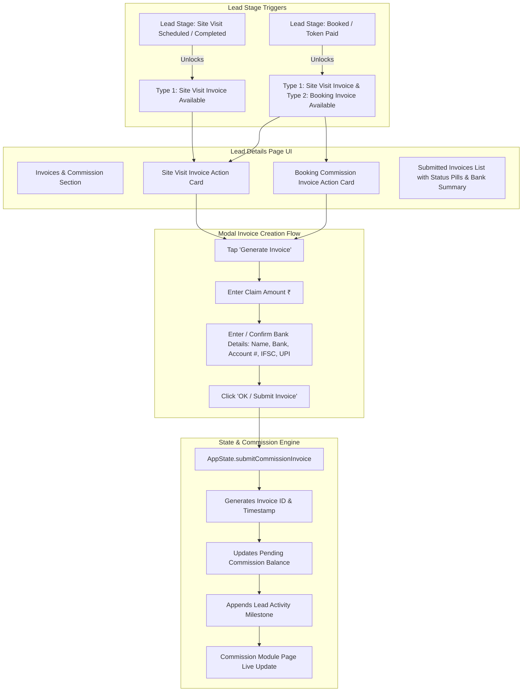

# CP CRM - Commission Module & Dual-Type Lead Invoices Implementation Plan

## 1. Executive Summary & Objectives
This document provides a comprehensive blueprint to implement:
1. **A Dedicated Commission Module Page (`CommissionScreen`)**:
   - Executive financial dashboard displaying:
     - **Total Commission Claimed** (₹)
     - **Pending Approval / In-Process** (₹)
     - **Disbursed / Paid Payouts** (₹)
     - **Active Invoices Count** (Site Visit vs. Booking breakdowns).
   - Filterable invoice list by status (`All`, `Pending`, `Approved`, `Paid`) and type (`Site Visit`, `Booking`).
   - Detailed invoice cards with status pills, payout timeline, bank account details, and 1-tap digital receipt preview.
   - Global `+ Create Custom Invoice` action.
2. **Dual-Type Invoices in the Lead Details Page (`LeadDetailScreen`)**:
   - **Type 1: Site Visit Invoice (Site Visit Incentive / Payout)**:
     - Automatically unlocked when the lead status is updated to **Site Visit** (`visitScheduled` or `visitCompleted`).
     - Enables CP to claim site tour travel/honorarium fee (e.g. ₹3,000 – ₹10,000 per visit).
   - **Type 2: Booking Commission Invoice (Final Success Brokerage)**:
     - Automatically unlocked when the lead status is updated to **Booked** (`tokenPaid`).
     - When a lead is marked as Booked, **both** Type 1 (Site Visit Invoice) and Type 2 (Booking Commission Invoice) are accessible.
3. **Interactive Invoice Submission Flow (Amount + Bank Details + OK Action)**:
   - Tap **"Generate Site Visit Invoice"** or **"Generate Booking Invoice"**.
   - Input **Claim Amount (₹)**.
   - Enter/Confirm **Bank Details** (Account Holder Name, Bank Name, Account Number, IFSC Code, optional UPI ID) with automatic profile pre-fill.
   - Tap **"OK / Submit Invoice"**:
     - Generates unique invoice reference (e.g. `INV-VIS-1042` or `INV-BKG-8819`).
     - Adds invoice and amount to the CP's active commission balance.
     - Logs milestone event on lead activity timeline.
     - Generates digital branded invoice pass.

---

## 2. Architectural & Workflow Diagram



---

## 3. Detailed Specifications

### 3.1. Lead Details Page - "Invoices & Commission Claims" Card
In [`lead_detail_screen.dart`](file:///c:/Users/Y%20SRI%20VAISHNAVI/OneDrive/Desktop/CP%20CRM/lib/features/leads/lead_detail_screen.dart), a dedicated **"Invoices & Commission"** module will be added with dynamic states:

1. **State A: Lead in New / Contacted stage**:
   - Status banner: *"Invoices unlock upon Site Visit or Booking status."*
2. **State B: Lead in Site Visit stage**:
   - **Site Visit Invoice**: Active & Unlocked.
     - If not generated: Displays `"Generate Site Visit Invoice"` button with badge `🎁 Available to Claim`.
     - If generated: Displays invoice card with `INV-VIS-XXXX`, claim amount (e.g. `₹5,000`), bank details badge, and status pill (`🟡 Pending Approval` / `🟢 Approved`).
   - **Booking Commission Invoice**: Locked (displays *"Unlocks upon booking confirmation"*).
3. **State C: Lead in Booked stage**:
   - **Site Visit Invoice**: Active & Unlocked (can be claimed if not yet submitted).
   - **Booking Commission Invoice**: Active & Unlocked.
     - If not generated: Displays `"Generate Booking Commission Invoice"` button with badge `🔥 Unlocked (Success Fee)`.
     - If generated: Displays invoice card with `INV-BKG-XXXX`, brokerage amount (e.g. `₹1,85,000`), linked bank account, and payout status.

---

### 3.2. Invoice Generation & Bank Details Modal (`InvoiceSubmissionModal`)
When the CP taps "Generate Site Visit Invoice" or "Generate Booking Invoice":
- **Header**: `Submit <Type> Invoice` with receipt icon.
- **Lead & Project Context**: Customer name (`visa`), Project (`Summer Park`), and RERA reference.
- **Amount Field**:
  - Currency input field with `₹` prefix and quick auto-fill suggestions (e.g. ₹5,000 for Site Visit, or 2% deal value calculation for Booking).
- **Bank Account Details Form**:
  - **Account Holder Name**: (e.g. `Rahul Sharma / Apex Realty`).
  - **Bank Name**: (e.g. `HDFC Bank`, `ICICI Bank`, `SBI`).
  - **Account Number**: (e.g. `50100293847561`).
  - **IFSC Code**: (e.g. `HDFC0001234`).
  - **UPI ID (Optional)**: (e.g. `rahul@okhdfcbank`).
  - Checkbox: *"Save this bank account as my default payout method."*
- **Action Buttons**:
  - `Cancel`
  - **`OK / Submit Invoice`** (Primary Indigo Button):
    - Validates inputs.
    - Emits invoice to `AppState`.
    - Triggers confirmation snackbar: *"Invoice <INV-ID> of ₹<Amount> submitted successfully! Track payout in Commission Module."*

---

### 3.3. Dedicated Commission Module Page (`CommissionScreen`)
A new high-impact module [`lib/features/commissions/commissions_screen.dart`](file:///c:/Users/Y%20SRI%20VAISHNAVI/OneDrive/Desktop/CP%20CRM/lib/features/commissions/commissions_screen.dart):
1. **Financial Overview KPI Header**:
   - 4 Cards:
     - 💼 **Total Invoiced**: Total cumulative claims submitted (e.g. `₹17.00 Lakhs`).
     - ⏳ **Pending Approval**: Invoices currently in verification (e.g. `₹4.20 Lakhs`).
     - 💰 **Disbursed / Received**: Funds credited to bank account (e.g. `₹12.80 Lakhs`).
     - 📄 **Active Invoices**: Total invoice count.
2. **Category Tabs & Status Filter**:
   - Tabs: `All Invoices` | `Site Visit Invoices` | `Booking Invoices`.
   - Status Filters: `All` | `Pending` | `Approved` | `Paid`.
3. **Invoices List**:
   - Each card displays:
     - Invoice ID (e.g. `INV-VIS-1084`) + Type badge (`Site Visit Payout` / `Booking Brokerage`).
     - Lead Name + Project Name.
     - Amount in bold typography (`₹5,000` / `₹1,85,000`).
     - Bank summary: `HDFC Bank ••••7561 (IFSC: HDFC0001234)`.
     - Date of submission & status badge.
     - **Actions**: `View Digital Invoice Receipt` & `Share PDF Pass via WhatsApp / Email`.
4. **Digital Receipt Preview Modal**:
   - Styled printable tax invoice card with CP details, Builder firm name, breakdown, bank confirmation, and approval watermark.

---

## 4. Data Models & State Architecture

### 4.1. New Models in `app_models.dart`

```dart
enum InvoiceType {
  siteVisit,
  booking,
}

enum InvoiceStatus {
  pending,
  approved,
  paid,
  rejected,
}

class BankDetailsModel {
  final String accountHolder;
  final String bankName;
  final String accountNumber;
  final String ifscCode;
  final String? upiId;

  BankDetailsModel({
    required this.accountHolder,
    required this.bankName,
    required this.accountNumber,
    required this.ifscCode,
    this.upiId,
  });
}

class CommissionInvoiceModel {
  final String id;
  final String invoiceNumber;
  final String leadId;
  final String clientName;
  final String projectId;
  final String projectName;
  final InvoiceType type;
  final double amount;
  final DateTime date;
  InvoiceStatus status;
  final BankDetailsModel bankDetails;
  final String? notes;

  CommissionInvoiceModel({
    required this.id,
    required this.invoiceNumber,
    required this.leadId,
    required this.clientName,
    required this.projectId,
    required this.projectName,
    required this.type,
    required this.amount,
    required this.date,
    this.status = InvoiceStatus.pending,
    required this.bankDetails,
    this.notes,
  });
}
```

### 4.2. State Methods in `AppState`
1. `List<CommissionInvoiceModel> get allInvoices`: Global list of all invoices.
2. `List<CommissionInvoiceModel> getInvoicesForLead(String leadId)`: Returns invoices linked to a specific lead.
3. `double get totalCommissionClaimed`: Sum of all invoice amounts.
4. `double get pendingCommissionAmount`: Sum of pending invoice amounts.
5. `double get paidCommissionAmount`: Sum of paid invoice amounts.
6. `void submitCommissionInvoice(...)`:
   - Adds invoice to `_invoices`.
   - Links invoice to the lead.
   - Appends milestone to `lead.activityList`: *"Site Visit Invoice INV-VIS-XXXX of ₹5,000 submitted"*.
   - Sends in-app notification.
   - Notifies all listeners for instant reactive UI updates.
7. `BankDetailsModel? get savedBankDetails`: Saved default CP bank account.
8. `void saveDefaultBankDetails(BankDetailsModel details)`: Persists CP bank details.

---

## 5. Implementation Phases & Tasks

### Phase 1: Models & AppState Extensions
- [ ] Add `InvoiceType`, `InvoiceStatus`, `BankDetailsModel`, and `CommissionInvoiceModel` to `app_models.dart`.
- [ ] Add `invoices` list and calculation getters (`totalCommissionClaimed`, `pendingCommissionAmount`, `paidCommissionAmount`) in `app_state.dart`.
- [ ] Add `submitCommissionInvoice` and `saveDefaultBankDetails` methods in `app_state.dart`.
- [ ] Seed initial mock invoices in `mock_data_service.dart` for demo leads (`lead_visa`, `lead_1`, `lead_3`).

### Phase 2: Lead Details Page "Invoices & Commission" Module
- [ ] Add `_buildInvoicesSection` to `lib/features/leads/lead_detail_screen.dart`.
- [ ] Add dynamic logic:
  - When stage is `visitScheduled` or `visitCompleted`: Show Site Visit invoice option.
  - When stage is `tokenPaid` (Booked): Show both Site Visit and Booking invoice options.
- [ ] Create `_showGenerateInvoiceModal` with amount input, bank details form, and `OK` submission button.
- [ ] Render submitted invoice cards with status pills and `View Receipt` dialog.

### Phase 3: Build Dedicated Commission Module Page
- [ ] Create `lib/features/commissions/commissions_screen.dart`.
- [ ] Implement 4 financial summary KPI cards.
- [ ] Implement category tab switcher (`All`, `Site Visit`, `Booking`) and status filters.
- [ ] Build invoice cards list with bank details summary and 1-tap receipt popup dialog.
- [ ] Connect navigation to Commission Page from:
  - Bottom navigation / App drawer / Dashboard KPI card.
  - Lead details page link: `"View all in Commission Hub →"`.

### Phase 4: Integration, Unit Tests & Verification
- [ ] Write unit tests in `test/commission_invoices_test.dart`:
  - Test Site Visit invoice unlock upon status change.
  - Test Booking invoice unlock upon booking.
  - Test amount calculation and bank details persistence.
  - Test AppState commission totals update.
- [ ] Run `flutter test` and test responsive layout on dark and light themes.

---

## 6. Verification & Acceptance Criteria
- [x] CP can generate a **Site Visit Invoice** after marking lead as Site Visit.
- [x] CP can generate both **Site Visit Invoice** and **Booking Commission Invoice** after marking lead as Booked.
- [x] CP enters **Amount (₹)** and **Bank Details** with a clear **OK** confirmation button.
- [x] Submitted invoices immediately reflect in the **Commission Module Page** with accurate totals.
- [x] Bank details are displayed and safely preserved.
- [x] All unit and integration tests pass with zero errors.
