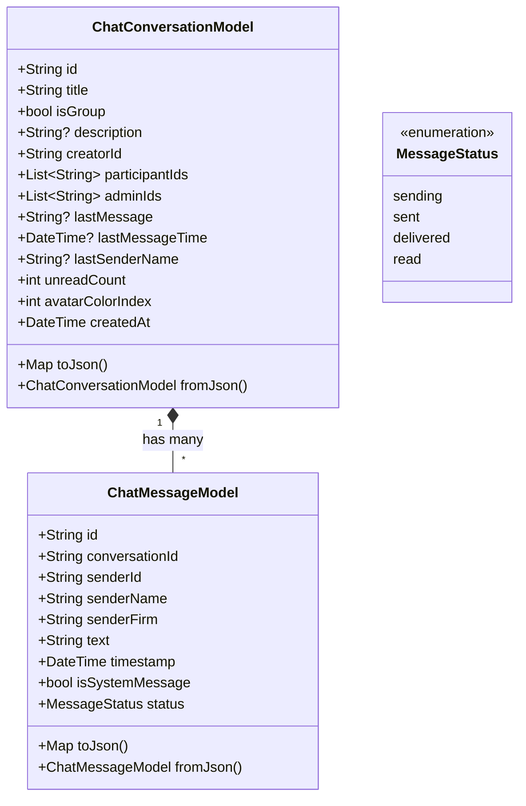

# Implementation Plan: CP-to-CP Messaging & Group Chat System

> **Document Version:** 1.0.0  
> **Target Module:** CP Community Messaging (`lib/features/chat/`)  
> **Status:** Ready for Review & Approval  
> **Core Requirement:** Enable all Channel Partners (CPs) to text 1-on-1 and form group chats, with **strict prohibition of phone/voice/video calls**.

---

## 1. Executive Summary

This plan outlines the architecture, state management, UI/UX screens, privacy rules, and test strategy for introducing real-time peer messaging among Channel Partners (CPs) within the CP CRM Flutter application.

### Key Capabilities:
1. **Direct Peer-to-Peer Messaging (1-on-1):** Any CP can discover peer CPs from the verified network directory and exchange direct text messages.
2. **CP Group Chats:** Any CP can create new group chats (e.g., regional masterminds, co-broking circles, project-specific investor pools), assign titles, select members, and manage participants.
3. **Strict "No-Call" Policy:** Absolute enforcement against phone calling. Zero voice/video call buttons in any chat UI, masked phone numbers, and no clickable phone dialers (`tel:` links).

---

## 2. Strict "No-Call" Policy & Privacy Matrix

The user requirement explicitly mandates that **CPs are NOT allowed to call each other, only text**:

| Touchpoint | Implementation Rule | Verification Method |
| :--- | :--- | :--- |
| **Chat AppBar (1:1 & Group)** | **Zero Call Action Icons:** Prohibit `Icons.phone`, `Icons.call`, `Icons.videocam`, or any dialer actions. Only text-oriented actions (`Search`, `Mute Notifications`, `Clear Chat`, `Group Info`) are rendered. | Automated widget tests asserting `find.byIcon(Icons.phone)` and `find.byIcon(Icons.call)` return `findsNothing`. |
| **Group Info & Member Directory** | Members list displays Name, Firm Name, City, and RERA badge. Action button is exclusively **"Message Privately"** (Direct Text). | Code inspection & widget tests confirming no dialer triggers. |
| **Phone Number Privacy** | Phone numbers are masked (e.g., `+91 98*** ***10`) or completely omitted in CP community profiles to prevent out-of-band dialer copy/paste. | Visual checks and assertions on rendered user tiles. |
| **URL Launcher Guard** | No `tel:`, `callto:`, or external calling URL triggers inside `lib/features/chat/`. | Static analysis & code search. |

> **Note:** The existing Builder SPOC Helpdesk screen handles builder escalation contacts separately. Within the **CP Community & Networking** feature, all interactions are strictly text-only.

---

## 3. Data Architecture & Models

New file: `lib/core/models/chat_models.dart` (and re-exported via `lib/core/models/app_models.dart`).



---

## 4. State Management & Persistence (`AppState`)

Extend `lib/core/state/app_state.dart` to manage chat threads, direct messaging, and group creation reactively.

### State Variables & Getters:
```dart
List<ChatConversationModel> _conversations = [];
Map<String, List<ChatMessageModel>> _chatMessages = {}; // Key: conversationId
List<UserModel> _networkCps = []; // Verified peer Channel Partners

List<ChatConversationModel> get conversations => _conversations;
int get totalUnreadChatCount => _conversations.fold(0, (sum, c) => sum + c.unreadCount);
List<UserModel> get networkCps => _networkCps;
```

### Methods in `AppState`:
1. `Future<void> _loadChatData(String userId)`:
   - Reads `persisted_chats_$userId` and `persisted_messages_$userId` from `SharedPreferences`.
   - If empty, loads realistic pre-seeded network CPs and active mastermind groups (e.g., *"Hyderabad West Luxury Network"*, *"Bangalore Commercial Mastermind"*).
2. `void sendChatMessage({required String conversationId, required String text})`:
   - Appends new outgoing message.
   - Updates conversation preview, moves it to top of list, persists data, calls `notifyListeners()`.
3. `ChatConversationModel createGroupChat({required String groupName, String? description, required List<UserModel> selectedMembers, int colorIndex = 0})`:
   - Auto-includes `currentUser` as creator/admin.
   - Appends system message: *"[User Name] created group '[groupName]'"*.
   - Stores and notifies listeners.
4. `ChatConversationModel getOrCreateDirectChat(UserModel targetCp)`:
   - Finds existing 1:1 conversation or generates a new direct conversation thread.
5. `void addMembersToGroup(String conversationId, List<UserModel> newMembers)`:
   - Updates member list and posts system announcement in group.
6. `void leaveGroup(String conversationId)`:
   - Removes current user and posts system update.
7. `void markConversationAsRead(String conversationId)`:
   - Clears unread badge for that conversation.

---

## 5. Screen & UI Flow Breakdown

```
lib/features/chat/
├── chat_list_screen.dart            # Main CP Community hub with filter tabs
├── chat_conversation_screen.dart    # 1:1 and Group messaging view (Strictly text-only)
├── create_group_chat_modal.dart     # Group setup (Name, Topic, Multi-CP select)
├── group_info_sheet.dart            # Group details, member directory, leave group
└── cp_directory_modal.dart          # Select CP to initiate 1:1 direct chat
```

### Screen Details:

### A. `ChatListScreen` (`lib/features/chat/chat_list_screen.dart`)
- **Header**:
  - Title: *"CP Community & Messages"*
  - Subtitle: *"Verified Channel Partner Network"*
  - Search toggle button
- **Notice Banner**:
  - *"🔒 Text-Only Network: Voice & phone calls are strictly disabled to protect broker privacy. Co-broke and discuss deals securely via text."*
- **Filter Tabs**:
  - `All` | `Direct (1:1)` | `Groups`
- **Conversation List Tile**:
  - 1:1 Tile: Partner Avatar with online dot, Name, Firm Name, preview snippet, time, unread badge.
  - Group Tile: Gradient group icon, `[Group]` pill badge, sender prefix, time, unread badge.
- **Floating Action Button (FAB)**:
  - Tapping opens bottom sheet:
    1. **"New Direct Message"** → Opens `CpDirectoryModal`
    2. **"Create Group Chat"** → Opens `CreateGroupChatModal`

### B. `ChatConversationScreen` (`lib/features/chat/chat_conversation_screen.dart`)
- **AppBar**:
  - 1:1: Partner Avatar, Partner Name, Firm Name subtitle.
  - Group: Group Avatar, Group Name, *"X participants"* (tap opens `GroupInfoSheet`).
  - **Explicitly NO call/video icon buttons.**
  - Menu options: *"Search Messages"*, *"Mute Notifications"*, *"Clear Chat"*.
- **Message List**:
  - Reverse list view grouped with date dividers (*"Today"*, *"Yesterday"*).
  - Outgoing bubbles: Electric Royal Blue (`#2563EB`), right-aligned, delivery checkmarks.
  - Incoming bubbles: Card surface background, left-aligned.
  - **In Groups**: Displays Sender Name and Firm Name in a distinct colored pill directly above incoming bubbles.
  - System messages: Centered subtle capsule cards.
- **Broker Quick-Reply Chips**:
  - Horizontal bar above text input with common co-broking shortcuts:
    - *"Any 3BHK inventory available?"*
    - *"Have an active buyer for Ready-to-Move"*
    - *"Open for 50:50 co-broking?"*
    - *"Sharing site visit details"*
- **Input Bar**:
  - Rounded text field, emoji shortcuts, and send button.

### C. `CreateGroupChatModal` (`lib/features/chat/create_group_chat_modal.dart`)
- **Step 1: Group Identity**:
  - Group Name input (Required, e.g., *"West Hyderabad Mastermind"*).
  - Description / Topic input (Optional, e.g., *"Luxury villas & co-broking deals"*).
  - Avatar Gradient Picker (choice of 6 visual gradient presets).
- **Step 2: Member Selection**:
  - Live search bar filtering peer CPs by Name, Firm, or City.
  - Horizontal chip row of selected CPs with removal `(x)` buttons.
  - Checkbox list of all verified CPs with Name, Firm, and RERA number.
- **Footer**:
  - Large **"Create Group Chat"** action button (validates non-empty title and at least 1 selected participant).

### D. `GroupInfoSheet` (`lib/features/chat/group_info_sheet.dart`)
- Large group badge, Title, Description, Creation Date, and Creator tag.
- Action: **"Add Members"** (opens selection sheet for existing group).
- **Participants List**:
  - Displays avatar, name, firm name, and `Admin` or `Member` badge.
  - Action per member: **"Message Privately"** (opens 1:1 text chat).
  - **NO phone call buttons, NO phone numbers displayed.**
- Danger Action: **"Leave Group"** with confirmation dialog.

### E. `CpDirectoryModal` (`lib/features/chat/cp_directory_modal.dart`)
- Searchable list of all verified peer CPs in the network.
- Tapping any CP instantly opens or resumes a 1:1 text conversation.

---

## 6. Access Points & Navigation Integration

1. **Dashboard Top App Bar**:
   - Add a Chat icon button (`Icons.forum_outlined`) with an unread badge counter next to the Notification Bell in `lib/features/dashboard/dashboard_screen.dart`.
2. **Dashboard Community Section**:
   - A dedicated *"CP Community & Networking"* card on the Dashboard showcasing active groups, recent unread messages, and a quick-action button to jump into chats.
3. **Navigation Shell Support**:
   - Integration in `lib/features/home/main_navigation_shell.dart` for smooth transitions.

---

## 7. Step-by-Step Rollout Phases

- **Phase 1: Foundation (Models & AppState)**
  - Implement `ChatMessageModel` and `ChatConversationModel` with JSON serialization.
  - Integrate chat stores, getters, methods, and user-scoped `SharedPreferences` persistence in `AppState`.
  - Provide pre-seeded network CPs and starter mastermind conversations in `MockDataService`.
- **Phase 2: Conversations List & Chat Screen**
  - Build `ChatListScreen` with "All", "Direct", and "Groups" tabs.
  - Build `ChatConversationScreen` with message bubbles, date grouping, broker quick replies, and **zero call buttons**.
- **Phase 3: Group Creation & Member Directory**
  - Implement `CreateGroupChatModal` with multi-select CP checkboxes and gradient selector.
  - Implement `GroupInfoSheet` with member list, "Message Privately" action, and "Leave Group".
  - Implement `CpDirectoryModal` for initiating 1:1 chats.
- **Phase 4: Dashboard Integration & Verification**
  - Connect Chat icon with unread badge in `DashboardScreen` top bar.
  - Add CP Community card on Dashboard.
  - Run all 87 existing tests + new dedicated chat test suite.

---

## 8. Automated Test Plan

Add new test file: `test/cp_chat_and_group_messaging_test.dart`

### Test Cases:
1. **Model Tests:**
   - `ChatMessageModel` serialization (`toJson` and `fromJson`).
   - `ChatConversationModel` serialization including participants and unread counts.
2. **State & Logic Tests:**
   - `AppState.sendChatMessage()` appends message and updates conversation preview.
   - `AppState.createGroupChat()` creates a new group with creator as admin and posts system welcome message.
   - `AppState.getOrCreateDirectChat()` returns existing thread or creates new 1:1 thread.
   - `AppState.totalUnreadChatCount` computes sum of unreads accurately.
   - `AppState.leaveGroup()` removes user from participant list.
3. **Widget & No-Call Compliance Tests:**
   - `ChatConversationScreen` renders conversation messages and input bar.
   - **Strict No-Call Assertion:** Verify that `find.byIcon(Icons.phone)`, `find.byIcon(Icons.call)`, and `find.byIcon(Icons.videocam)` return `findsNothing` on both 1:1 and Group chat screens.
   - `GroupInfoSheet` displays participants without any call icons or actionable phone numbers.
   - `CreateGroupChatModal` validates group name and member selection before submission.
