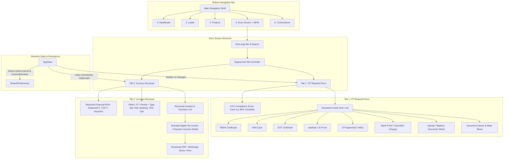

# CP CRM - "Docs" Page (CP Required Docs & Received Invoices) Implementation Plan

## 1. Executive Summary & Objectives

The goal of this feature is to introduce a dedicated **Docs** module in the CP CRM mobile app, accessible directly from the **Bottom Navigation Bar**. This page serves as the centralized document repository and financial receipt center for Channel Partners (Realtors & Agencies).

The **Docs Page** will contain two primary functional tabs:
1. **CP Required Docs (Partner KYC & Regulatory Compliance)**:
   - Mandatory and regulatory documents required for Channel Partner empanelment, active brokering, and commission payout clearance:
     - **RERA Registration Certificate** (Mandatory real estate agent registration).
     - **PAN Card** (Required for TDS Sec 194H tax deduction).
     - **GST Registration Certificate / Non-GST Declaration** (Tax compliance).
     - **Aadhaar / Government ID Proof** (Identity verification of authorized signatory).
     - **Channel Partner Agreement / MOU** (Empanelment contract with the developer).
     - **Cancelled Cheque / Bank Account Proof** (Bank verification for NEFT/RTGS disbursals).
   - Features: KYC Compliance Health Bar (% complete), Document status badges (`Verified`, `Under Review`, `Missing`, `Expiring Soon`), interactive Document Preview modal, 1-tap Upload/Replace action with camera/gallery picker simulation, and download/share actions.
2. **Invoices Received (Payout Slips, Builder Tax Invoices & TDS Certificates)**:
   - Official billing and financial documents received by the Channel Partner from the developer/builder finance desk:
     - **Commission Payment Disbursal Receipts / Credit Vouchers** (Issued upon payment execution for Site Visits & Bookings, with bank UTR reference).
     - **Builder Tax Invoices / Settlement Notes** (Formally acknowledged tax invoices for brokerage claims).
     - **Quarterly TDS Certificates (Form 16A)** (Income tax brokerage credit proofs for ITR filing).
   - Features: Financial KPI summary cards (Total Received, Active Vouchers, Net TDS Deducted), period & type filters (`All`, `Site Visit Payouts`, `Booking Commission`, `TDS 16A`), detailed interactive receipt cards, and a **Full-Page Branded Digital Tax Invoice & Disbursal Voucher Modal** complete with QR verification, itemized payout calculations, and PDF download/share actions.
3. **Seamless Navigation Bar Integration**:
   - Integration of a 5th navigation destination in [`main_navigation_shell.dart`](file:///c:/Users/Y%20SRI%20VAISHNAVI/OneDrive/Desktop/CP%20CRM/lib/features/home/main_navigation_shell.dart):
     - `Dashboard` (0)
     - `Leads` (1)
     - `Projects` (2)
     - `Docs` (3) *(or 4)* with an optional alert badge when documents are missing or pending review.
     - `Commissions` (4)

---

## 2. High-Level Architecture & Workflow Diagram



---

## 3. UI/UX Specifications

### 3.1. Navigation Bar Updates
- **File**: [`lib/features/home/main_navigation_shell.dart`](file:///c:/Users/Y%20SRI%20VAISHNAVI/OneDrive/Desktop/CP%20CRM/lib/features/home/main_navigation_shell.dart)
- **Nav Items (5 Items)**:
  1. `Dashboard` (`Icons.home_rounded` / `Icons.grid_view_outlined`)
  2. `Leads` (`Icons.people_alt_rounded` / `Icons.people_alt_outlined`)
  3. `Projects` (`Icons.apartment_rounded` / `Icons.apartment_outlined`)
  4. `Docs` (`Icons.folder_shared_rounded` / `Icons.folder_shared_outlined`) — *Displays warning badge if mandatory docs are missing!*
  5. `Commissions` (`Icons.account_balance_wallet_rounded` / `Icons.account_balance_wallet_outlined`)
- **Responsive Layout**: Even spacing across screen width with active indicator styling, subtle pill background, and dark mode support.

---

### 3.2. Docs Screen (`DocsScreen`)
- **File**: `lib/features/docs/docs_screen.dart`
- **Header**:
  - Title: **"Documents & Billing"** or **"Docs"**.
  - Subtitle: *"Channel Partner KYC compliance and builder invoices received"*.
  - Actions: Quick Search icon, Filter icon, or Quick Upload icon.
- **Segmented Tab Switcher**:
  - Two high-contrast, rounded pill tabs:
    - **Tab 1: CP Required Docs** (with badge: `5/6 Verified`)
    - **Tab 2: Invoices Received** (with badge: `12 Receipts`)
  - Smooth animation on tab switch, haptic feedback, and preserved scroll position.

---

### 3.3. Tab 1: CP Required Docs
#### A. KYC Compliance Health Card
- Gradient hero container (`Color(0xFF2563EB)` to `Color(0xFF1D4ED8)`):
  - Radial or Linear Progress indicator showing compliance (e.g. **83% Complete**).
  - Status message: *"5 of 6 mandatory documents verified. Upload Bank Proof to enable automatic instant payouts."*
  - Quick action: `Complete KYC →`.

#### B. Category Filter / Document Type Chips
- `All Documents`, `Mandatory (KYC)`, `Tax & Legal`, `Agreements`.

#### C. Document Cards List
Each document item card will display:
- **Left Icon Container**: Color-coded icon by doc type (`Icons.verified_user_rounded` for RERA, `Icons.badge_rounded` for PAN, `Icons.receipt_long_rounded` for GST, `Icons.account_balance_rounded` for Bank, `Icons.description_rounded` for Agreement).
- **Doc Title & Number**:
  - Title: e.g. **RERA Registration Certificate**
  - Document / Identifier: e.g. `A51800034921`
  - Valid Till: e.g. `Valid till 31 Dec 2026`
- **Status Pill**:
  - `🟢 Verified` (Emerald green container with checkmark)
  - `🟡 Under Review` (Amber container with clock icon)
  - `🔴 Expired / Action Required` (Rose container with warning icon)
  - `⚪ Missing` (Slate/Grey container with plus icon)
- **Trailing Actions**:
  - Tap card to open **Document Preview & Details Sheet**.
  - Quick action menu: `Upload / Update`, `Download Copy`, `Share`.

#### D. Interactive Upload / Update Modal (`UploadDocumentModalSheet`)
- Bottom sheet allowing the CP to:
  - Select Document Type.
  - Enter / Confirm Document Number (e.g., PAN No, RERA No, GSTIN).
  - Select Expiry Date (if applicable).
  - Choose Upload Source: `📷 Camera Capture` or `📁 File / Gallery Picker`.
  - Display file preview thumbnail, file size, and upload progress animation.
  - "Submit for Verification" action that automatically updates `AppState` and marks the status as `Under Review`.

---

### 3.4. Tab 2: Invoices Received
#### A. Financial Received Summary Stats
A 3-card horizontal stat banner:
1. **Total Disbursed (Received)**: e.g. `₹4,85,000` (Gross payouts received from builder).
2. **Net Bank Credited**: e.g. `₹4,60,750` (Net credited after 5% TDS deduction).
3. **TDS Certificates (16A)**: e.g. `₹24,250` across 4 quarters available for tax credit.

#### B. Filter Bar
- **Financial Year Picker**: `FY 2024 - 2025`, `FY 2023 - 2024`, `All Periods`.
- **Type Filter Chips**: `All`, `Site Visit Payouts`, `Booking Commission`, `Tax Invoices`, `TDS Form 16A`.

#### C. Received Invoice & Voucher Cards
Each card displays:
- **Header**: Voucher ID (e.g. `REC-VIS-1042` or `DISB-BKG-8819`), Date (e.g. `12 Oct 2024`).
- **Lead / Deal Reference**:
  - Customer: `Visa Rao`
  - Project: `Summer Park, Hyderabad`
  - Unit: `Tower A - 402`
- **Payout Breakdown**:
  - Gross Amount: `₹1,85,000`
  - TDS (5% Sec 194H): `- ₹9,250`
  - Net Credited: **`₹1,75,750`**
- **Disbursal Details**:
  - Bank: `HDFC Bank (•••• 4921)`
  - Bank Reference / UTR: `UTR-HDFC889210492`
  - Status Pill: `🟢 Credited to Account`
- **Card Actions**:
  - `👁️ View Receipt` (Opens full digital branded tax invoice voucher).
  - `⬇️ Download PDF` (Simulated instant PDF generation & export).
  - `📤 WhatsApp / Share` (Quick share link/receipt text).

#### D. Full Digital Tax Invoice / Payment Voucher Modal (`ReceivedInvoiceVoucherModal`)
A clean, printable invoice voucher layout:
- **Header**: Builder / Developer Logo, Firm Name, Registered Address, Corporate Identity Number (CIN), GSTIN.
- **Title**: **"OFFICIAL COMMISSION DISBURSAL VOUCHER & TAX INVOICE"**.
- **Partner Details Box**: Channel Partner Name, Firm, RERA ID, PAN, GSTIN, Linked Bank Account.
- **Transaction Particulars**:
  - Voucher No, Voucher Date, Payment Mode (NEFT/RTGS), UTR No, Transfer Timestamp.
- **Service Description Table**:
  - Item: *"Channel Partner Brokerage - Booking of Unit A-402, Summer Park"*.
  - Base Brokerage Claimed: `₹1,85,000.00`.
  - GST @ 18% (if registered): `₹0.00` (or applicable GST).
  - Less: TDS Deducted under Section 194H @ 5%: `₹9,250.00`.
  - **Net Disbursed & Paid**: **`₹1,75,750.00`**.
- **Footer**: QR Code for authenticity verification, Authorized Signatory digital signature seal, and terms/notes.
- **Actions**: `Share PDF`, `Print / Save`, `Close`.

---

## 4. Data Models & State Management

### 4.1. New Data Models in `lib/core/models/app_models.dart`

```dart
enum CpDocumentType {
  reraCertificate,
  panCard,
  gstCertificate,
  aadhaarCard,
  cpAgreement,
  cancelledCheque,
  other,
}

enum CpDocumentStatus {
  verified,
  underReview,
  missing,
  expired,
}

class CpDocumentModel {
  final String id;
  final CpDocumentType type;
  final String title;
  final String documentNumber;
  final String? fileUrl;
  final String? fileName;
  final String? fileSize;
  final DateTime? uploadedAt;
  final DateTime? expiresAt;
  final CpDocumentStatus status;
  final bool isMandatory;
  final String? remarks;

  CpDocumentModel({
    required this.id,
    required this.type,
    required this.title,
    required this.documentNumber,
    this.fileUrl,
    this.fileName,
    this.fileSize,
    this.uploadedAt,
    this.expiresAt,
    this.status = CpDocumentStatus.missing,
    this.isMandatory = true,
    this.remarks,
  });

  Map<String, dynamic> toJson() => { ... };
  factory CpDocumentModel.fromJson(Map<String, dynamic> json) => ...;
  CpDocumentModel copyWith({ ... }) => ...;
}

enum ReceivedInvoiceType {
  siteVisitPayout,
  bookingBrokerage,
  builderTaxInvoice,
  tdsCertificate16A,
}

enum ReceivedInvoiceStatus {
  credited,
  processing,
  underReview,
}

class ReceivedInvoiceModel {
  final String id;
  final String voucherNumber;
  final String invoiceNumber;
  final String leadId;
  final String clientName;
  final String projectId;
  final String projectName;
  final String? unitNumber;
  final ReceivedInvoiceType type;
  final double grossAmount;
  final double tdsRate; // e.g. 0.05 (5%)
  final double tdsAmount;
  final double netAmount;
  final DateTime disbursedDate;
  final ReceivedInvoiceStatus status;
  final String bankName;
  final String bankAccountNumber; // Masked e.g. "•••• 4821"
  final String utrNumber;
  final String? financialYear;
  final String? notes;

  ReceivedInvoiceModel({
    required this.id,
    required this.voucherNumber,
    required this.invoiceNumber,
    required this.leadId,
    required this.clientName,
    required this.projectId,
    required this.projectName,
    this.unitNumber,
    required this.type,
    required this.grossAmount,
    this.tdsRate = 0.05,
    required this.tdsAmount,
    required this.netAmount,
    required this.disbursedDate,
    this.status = ReceivedInvoiceStatus.credited,
    required this.bankName,
    required this.bankAccountNumber,
    required this.utrNumber,
    this.financialYear = 'FY 2024-25',
    this.notes,
  });

  Map<String, dynamic> toJson() => { ... };
  factory ReceivedInvoiceModel.fromJson(Map<String, dynamic> json) => ...;
}
```

---

### 4.2. State Methods in `lib/core/state/app_state.dart`

```dart
// Document State
List<CpDocumentModel> _cpDocuments = [];
List<CpDocumentModel> get cpDocuments => _cpDocuments;

// Received Invoices State
List<ReceivedInvoiceModel> _receivedInvoices = [];
List<ReceivedInvoiceModel> get receivedInvoices => _receivedInvoices;

// Helper getters
int get missingMandatoryDocsCount => 
    _cpDocuments.where((d) => d.isMandatory && (d.status == CpDocumentStatus.missing || d.status == CpDocumentStatus.expired)).length;

double get kycCompletionPercentage {
  final mandatory = _cpDocuments.where((d) => d.isMandatory).toList();
  if (mandatory.isEmpty) return 1.0;
  final verified = mandatory.where((d) => d.status == CpDocumentStatus.verified).length;
  return verified / mandatory.length;
}

double get totalReceivedDisbursedAmount =>
    _receivedInvoices.fold(0.0, (acc, item) => acc + item.grossAmount);

double get totalNetReceivedAmount =>
    _receivedInvoices.fold(0.0, (acc, item) => acc + item.netAmount);

double get totalTdsDeductedAmount =>
    _receivedInvoices.fold(0.0, (acc, item) => acc + item.tdsAmount);

// Mutation Methods
Future<void> uploadOrUpdateDocument({
  required String documentId,
  required String documentNumber,
  required String fileName,
  DateTime? expiresAt,
});

Future<void> deleteDocument(String documentId);

void addReceivedInvoice(ReceivedInvoiceModel invoice);
```

---

### 4.3. Mock Data in `lib/core/services/mock_data_service.dart`
- Initial seed data for `_cpDocuments`:
  1. **RERA Certificate**: `A51800034921` (Verified, Valid till Dec 2026).
  2. **PAN Card**: `ABCDE1234F` (Verified).
  3. **GST Certificate**: `36ABCDE1234F1Z5` (Verified).
  4. **Aadhaar Card**: `XXXX-XXXX-8921` (Verified).
  5. **Channel Partner Agreement**: `CPA-2024-902` (Verified, Platinum Partner Tier).
  6. **Bank Account Proof / Cheque**: `HDFC Bank - 0029` (Under Review / Needs upload).
- Initial seed data for `_receivedInvoices`:
  1. `DISB-BKG-8819` (Booking Commission for Visa Rao, Summer Park Unit A-402, Gross ₹1,85,000, TDS ₹9,250, Net ₹1,75,750, UTR `UTR-HDFC889210492`).
  2. `DISB-VIS-1042` (Site Visit Honorarium for Visa Rao, Summer Park, Gross ₹5,000, TDS ₹250, Net ₹4,750, UTR `UTR-HDFC771029104`).
  3. `DISB-BKG-7712` (Booking Commission for Rahul Sharma, Prestige Highline Unit B-1204, Gross ₹2,40,000, TDS ₹12,000, Net ₹2,28,000, UTR `UTR-ICIC993102451`).
  4. `TDS-2024-Q2` (Form 16A TDS Certificate Q2 FY 24-25, ₹21,250 Tax Remitted to Govt).

---

## 5. Step-by-Step Implementation Roadmap

| Step | Component / File | Description |
| :--- | :--- | :--- |
| **Phase 1** | **Data Models & Enums**<br>[`app_models.dart`](file:///c:/Users/Y%20SRI%20VAISHNAVI/OneDrive/Desktop/CP%20CRM/lib/core/models/app_models.dart) | Define `CpDocumentModel`, `CpDocumentType`, `CpDocumentStatus`, `ReceivedInvoiceModel`, `ReceivedInvoiceType`, `ReceivedInvoiceStatus` with JSON serialization. |
| **Phase 2** | **Mock Data Seed**<br>[`mock_data_service.dart`](file:///c:/Users/Y%20SRI%20VAISHNAVI/OneDrive/Desktop/CP%20CRM/lib/core/services/mock_data_service.dart) | Add `getInitialCpDocuments()` and `getInitialReceivedInvoices()` with realistic Indian real estate CP data. |
| **Phase 3** | **State Management & Persistence**<br>[`app_state.dart`](file:///c:/Users/Y%20SRI%20VAISHNAVI/OneDrive/Desktop/CP%20CRM/lib/core/state/app_state.dart) | Implement `_cpDocuments`, `_receivedInvoices`, KYC completion percentage calculation, and document upload/replace/delete actions with `SharedPreferences` caching. |
| **Phase 4** | **Docs Screen Core UI**<br>`lib/features/docs/docs_screen.dart` | Build scaffold, custom app bar with dark mode support, search/filter hooks, and 2-tab animated switcher (`CP Required Docs` & `Invoices Received`). |
| **Phase 5** | **Tab 1: CP Required Docs Widget & Modals**<br>`lib/features/docs/widgets/cp_documents_tab.dart` | Build KYC Compliance Progress Card, document card tiles with status pills, Document Viewer sheet, and Upload/Replace bottom sheet modal. |
| **Phase 6** | **Tab 2: Invoices Received Widget & Vouchers**<br>`lib/features/docs/widgets/received_invoices_tab.dart` | Build Received Financial Stats banner, FY & Type filter chips, received invoice list tiles, and Full Digital Tax Invoice/Payment Voucher modal (`ReceivedInvoiceVoucherModal`). |
| **Phase 7** | **Bottom Navigation Shell Integration**<br>[`main_navigation_shell.dart`](file:///c:/Users/Y%20SRI%20VAISHNAVI/OneDrive/Desktop/CP%20CRM/lib/features/home/main_navigation_shell.dart) | Add `Docs` as a 5th navigation destination in the bottom navigation bar with badging, index handling, and smooth transitions. |
| **Phase 8** | **Cross-Linking & Verification** | Link Dashboard quick actions and Profile screen to the new Docs tab; verify dark/light mode, filters, upload simulation, and PDF/share flows. |

---

## 6. Verification & Quality Checklist

- [ ] **Navigation Bar**: Tab index switches smoothly to `Docs` without layout overflow or distortion on mobile screens.
- [ ] **Tab Switching**: Seamlessly toggle between "CP Required Docs" and "Invoices Received" with preserved scroll positions.
- [ ] **KYC Progress Meter**: Percentage matches `verified / mandatory` documents ratio in real time.
- [ ] **Document Upload**: Tapping "Upload / Replace" updates document state to `Under Review` and reflects immediately across the app.
- [ ] **Invoices Received Filters**: Filtering by FY and type (`Site Visit`, `Booking`, `TDS 16A`) properly updates the visible list.
- [ ] **Payment Voucher Modal**: Accurately computes Gross, TDS 5%, and Net Disbursed amounts with authentic bank UTR reference.
- [ ] **Theme Support**: Flawless visual contrast in both Light Mode and Dark Mode.
- [ ] **Zero Compile/Lint Errors**: Passes `flutter analyze` cleanly.
