# CP CRM - Clean Slate & Independent Lead Creation Implementation Plan

## 1. Executive Summary
This document specifies the implementation plan to resolve two core issues in the CP CRM:
1. **Starting from Scratch with Zero Data**: When a new Channel Partner registers or logs in (e.g., account **ashvik**), the pipeline, dashboard, and lead details must start with **zero data** (0 Total Leads, 0 Site Visits, 0 Booked Deals, ₹0 Commission Received, ₹0 Commission Pending), rather than showing pre-loaded mock leads and figures.
2. **Independent Lead Creation (No Overriding)**: When a new lead is added, it must be created as an independent new record with a unique ID and isolated stats. Creating or updating a lead must **never overwrite or override** any existing lead in the CRM pipeline.

---

## 2. Root Cause Analysis

| Current Issue | Root Cause in Codebase | Consequence |
|---|---|---|
| **Pipeline shows 6 leads & ₹1.88L on fresh accounts** | In [`AppState._initData()`](file:///c:/Users/Y%20SRI%20VAISHNAVI/OneDrive/Desktop/CP%20CRM/lib/core/state/app_state.dart#L137-L148), `MockDataService.getInitialLeads()` (6 leads), `getInitialVisits()` (2 visits), and `getInitialInvoices()` (₹1.88L) are injected into global state on startup. | Every user (including new accounts like `ashvik`) starts with identical mock data instead of starting from scratch. |
| **All leads look identical in details** | In [`LeadDetailScreen._buildHeroCard()`](file:///c:/Users/Y%20SRI%20VAISHNAVI/OneDrive/Desktop/CP%20CRM/lib/features/leads/lead_detail_screen.dart#L696), `avatarNumber = '01'` is hardcoded. In [`_buildSiteVisitHistoryCard()`](file:///c:/Users/Y%20SRI%20VAISHNAVI/OneDrive/Desktop/CP%20CRM/lib/features/leads/lead_detail_screen.dart#L1510-L1515), site visits are matched loosely by `clientPhone` and `clientName`. | Any newly created lead displays "01" and may display site visits belonging to mock records. |
| **Potential Lead Overriding & Cross-Account Leaks** | `_persistLeads()` writes to a single global key `'persisted_leads'` in `SharedPreferences` without user scoping. | Changes made by one user can overwrite data for other users or persist mock leads permanently across accounts. |

---

## 3. Architecture & Data Flow

```mermaid
graph TD
    subgraph Current Architecture
        A1[App Startup / New User] --> B1[AppState injects MockDataService]
        B1 --> C1[6 Leads + 2 Visits + ₹1.88L Invoices forced into state]
        C1 --> D1[Global 'persisted_leads' overwrites all users]
        C1 --> E1[Lead Detail shows hardcoded '01' & mock visits]
    end

    subgraph Proposed Clean Architecture
        A2[User Login / Registration: ashvik] --> B2[Load User-Scoped Storage: persisted_leads_USERID]
        B2 -->|First Time / Clean Slate| C2[Initialized to EMPTY: 0 Leads, 0 Visits, ₹0 Commission]
        C2 --> D2[Dashboard Displays Clean 0 Stats]
        D2 --> E2[User Taps '+ Add Lead']
        E2 --> F2[Create Distinct Lead with Unique ID: lead_TIMESTAMP_RANDOM]
        F2 --> G2[Lead Appended without Overwriting Existing Leads]
        G2 --> H2[Dashboard Dynamically Increments: 0 to 1 to N]
        G2 --> I2[Lead Detail Screen: Dynamic Initials Avatar, 0 Visits, 0 Invoices]
        C2 -.->|Optional Demo Toggle| J2[Load Demo Sample Data on Demand]
    end
```



---

## 4. Detailed Implementation Changes

### 4.1. Step 1: User-Scoped Storage & Clean Slate Initialization
**Target File**: [`lib/core/state/app_state.dart`](file:///c:/Users/Y%20SRI%20VAISHNAVI/OneDrive/Desktop/CP%20CRM/lib/core/state/app_state.dart)

1. **User-Scoped Persistence Keys**:
   - Scope lead, invoice, and visit storage keys by user ID:
     - `'persisted_leads_${_currentUser?.id ?? "guest"}'`
     - `'persisted_invoices_${_currentUser?.id ?? "guest"}'`
     - `'persisted_visits_${_currentUser?.id ?? "guest"}'`
2. **Fresh Account Initialization**:
   - In `registerUser()`: initialize `_leads = []`, `_siteVisits = []`, `_invoices = []` so newly registered users start with zero records.
   - In `_initData()`: for new users without saved data, do not inject mock leads by default. Provide an explicit empty list (`[]`).
3. **Clean Slate & Demo Data Management**:
   - Add `resetToCleanSlate()`:
     - Clears leads, site visits, and invoices for the currently logged-in user.
     - Saves empty state to user-scoped storage.
     - Calls `notifyListeners()`.
     - *Allows active accounts like `ashvik` to immediately reset to all 0s with 1 tap.*
   - Add `loadSampleDemoData()`:
     - Allows loading the 6 sample mock leads and visits if the user ever wants to preview populated demo charts.

---

### 4.2. Step 2: Independent Lead Creation & Anti-Collision ID Engine
**Target File**: [`lib/core/state/app_state.dart`](file:///c:/Users/Y%20SRI%20VAISHNAVI/OneDrive/Desktop/CP%20CRM/lib/core/state/app_state.dart)

1. **Unique ID Generation**:
   - Replace simple milliseconds ID with microsecond precision + random salt:
     ```dart
     final uniqueId = 'lead_${now.microsecondsSinceEpoch}_${Random().nextInt(99999)}';
     ```
2. **Safe Lead Appending**:
   - In `addLead()`:
     - Ensure the new lead is inserted at index 0 without replacing or modifying any other list elements.
     - Default starting stage: `LeadStage.cold` (Ingested).
     - Initialize `siteVisitHistory = []`, `notesList = [if note entered]`, `activityList = [initial creation event]`.
     - Persist immediately to user-scoped storage.
3. **Strict Target Isolation in `updateLeadInfo()`**:
   - Target update strictly by `lead.id == leadId`.
   - Prevent any index cross-talk or mutation of adjacent leads.
   - Automatically persist changes to disk.

---

### 4.3. Step 3: Dynamic Lead Details & Isolation
**Target File**: [`lib/features/leads/lead_detail_screen.dart`](file:///c:/Users/Y%20SRI%20VAISHNAVI/OneDrive/Desktop/CP%20CRM/lib/features/leads/lead_detail_screen.dart)

1. **Dynamic Initials Avatar**:
   - Replace static `final avatarNumber = '01';` with initials computed from the lead's name:
     ```dart
     String get initials {
       final first = lead.firstName.trim().isNotEmpty ? lead.firstName.trim()[0].toUpperCase() : 'L';
       final last = lead.lastName.trim().isNotEmpty ? lead.lastName.trim()[0].toUpperCase() : '';
       return '$first$last';
     }
     ```
   - Color code avatar dynamically based on lead temperature or name hash, instead of static gold star for all leads.
2. **Strict Site Visit Filtering**:
   - In `_buildSiteVisitHistoryCard()`, filter visits **strictly** by lead ID:
     ```dart
     final visits = widget.state.siteVisits.where((v) => v.leadId == lead.id).toList();
     ```
   - Eliminates false positives where a new lead showed visits from mock records due to loose name or phone matching.
3. **Clean Empty States**:
   - Site Visits: "0 Site Visits Recorded" with "+ Schedule Visit" button.
   - Invoices: "0 Invoices Generated" with clear eligibility pills.

---

### 4.4. Step 4: Quick "Start From Scratch" Action in Dashboard & Profile
**Target Files**:
- [`lib/features/dashboard/dashboard_screen.dart`](file:///c:/Users/Y%20SRI%20VAISHNAVI/OneDrive/Desktop/CP%20CRM/lib/features/dashboard/dashboard_screen.dart)
- [`lib/features/profile/profile_screen.dart`](file:///c:/Users/Y%20SRI%20VAISHNAVI/OneDrive/Desktop/CP%20CRM/lib/features/profile/profile_screen.dart)

1. Add a **"Pipeline Data Mode"** section:
   - **"Start From Scratch (Reset All to 0)"**: Instantly clears mock pipeline data for the current account (`ashvik`), leaving a clean slate.
   - **"Load Sample Demo Data"**: Option to repopulate mock data if needed for testing.

---

## 5. Verification & Testing Protocol

| Test Case | Steps | Expected Result |
|---|---|---|
| **1. Fresh Account Start** | Log in as `ashvik` and tap "Start From Scratch" | Total Leads = 0, Sitevisited Leads = 0, Booked Leads = 0, Commission = ₹0, Pending = ₹0. |
| **2. Add Lead #1** | Tap "+ Add Lead", enter "Rahul Verma", phone: `9876543210`, project: "My Home Avatar" | Pipeline increments to 1 Total Lead. Sitevisited = 0, Booked = 0. |
| **3. Verify Lead #1 Details** | Tap "Rahul Verma" to open Lead Detail | Avatar displays "RV". Site Visits = 0. Invoices = 0. Activity shows only creation event. |
| **4. Add Lead #2 (No Override)** | Tap "+ Add Lead", enter "Sneha Patel", phone: `9876543211`, project: "Rajapushpa" | Pipeline increments to 2 Total Leads. Both "Rahul Verma" and "Sneha Patel" exist independently in the leads list. |
| **5. Edit Lead #1** | Change Rahul Verma's status to "Site Visited" | Only Rahul Verma changes to Site Visited. Sneha Patel remains "Cold". Booked remains 0. |
| **6. Browser Reload Persistence** | Refresh the browser / reload the app | Both leads remain saved and reload cleanly with the exact updated statuses. |

---

## 6. Execution Approval
Upon your review and confirmation, execution will proceed in the order outlined in Section 4.
