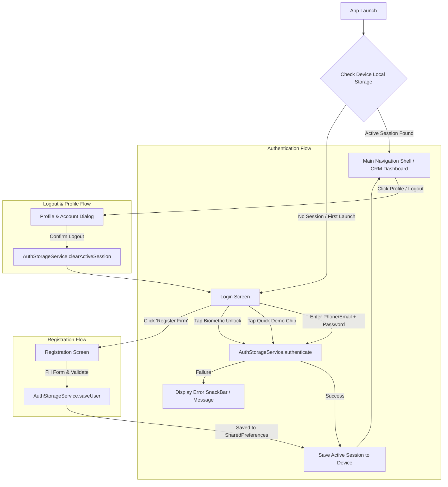

# CP CRM - Local Device Multi-Account Login & Registration Plan

## 1. Executive Summary
This document details the architecture and step-by-step implementation plan for adding a **multi-user Authentication and Registration system** to the **CP CRM** mobile application. 

All user credentials and profile records will be stored directly inside the device where the application is installed (using device-local `SharedPreferences` JSON storage). This enables multiple Channel Partners (CPs) and Sales Partners (SPs) / Independent Realtors to register, save credentials locally, log in, switch accounts, and retain their login sessions across app restarts.

---

## 2. Requirements & Functional Specifications

### 2.1. Multi-Account Local Storage
- **Device-Only Persistence**: All registered user data must be saved in the device's local storage (`SharedPreferences`) as serialized JSON. No external backend server is required for this standalone setup.
- **Pre-Seeded Demo Profiles**: On the first app launch, the app automatically initializes realistic demo CP/SP accounts (e.g., *Apex Realty Advisors*, *Horizon Elite Realtors*, *Vikram Seth Realty*) so testing and evaluation can be performed immediately without manual typing.
- **Session Persistence**: When a CP logs in, the active session is remembered on the device. Reopening the app directly opens the CRM dashboard for that CP unless they explicitly log out.

### 2.2. Login Page Capabilities (`LoginScreen`)
- **Credentials Login**: Login using registered **Phone Number** or **Email Address** + **Password**.
- **Show/Hide Password**: Interactive toggle icon.
- **Validation & Error Handling**: Clear feedback for unregistered mobile numbers or incorrect passwords.
- **Quick Demo Switcher**: One-tap selector chips to quickly log in as different CPs for fast demo and testing.
- **Biometric Quick Unlock**: Fast biometric simulation (Face ID / Fingerprint) for the last active user.
- **New Registration CTA**: Clear "New Channel Partner? Register Firm / Realtor" navigation button.

### 2.3. Registration Page Capabilities (`RegisterScreen`)
- **Partner Type Selection**: Toggle between:
  1. `Real Estate Agency / Firm` (includes Agency/Firm Name + Contact Person).
  2. `Individual Realtor / Sales Partner` (individual broker profile).
- **Mandatory Field Validation**:
  - Authorized Contact Person (Full Name)
  - Agency / Firm Name (if agency type)
  - RERA Registration Number (format verified)
  - Primary Mobile Number (10 digits, validated)
  - Email Address (valid email format)
  - Operating City & State
  - Password & Confirm Password
- **Duplicate Prevention**: Prevents registering with a mobile number or email that already exists on this device.
- **Immediate Device Save**: Writes new user to local storage and signs them in instantly.

### 2.4. Profile & Logout Management
- **Profile Avatar in Header & Dashboard**: Tapping the profile shows the active CP's details (Firm, RERA ID, Phone, City).
- **Logout Action**: Logs out the current user, clears the active device session, and returns to the `LoginScreen`.
- **Switch Account Option**: Allows switching between any locally saved CP accounts from the profile menu.

---

## 3. System Architecture & Flow



---

## 4. Data Models & Storage Schema

### 4.1. `UserModel` Definition
```dart
class UserModel {
  final String id;
  final String name;
  final String firmName;
  final String reraNumber;
  final String phone;
  final String email;
  final String city;
  final bool isAgency;
  final String? password;
  final String? logoUrl;
  final DateTime? registeredAt;

  UserModel({
    required this.id,
    required this.name,
    required this.firmName,
    required this.reraNumber,
    required this.phone,
    required this.email,
    required this.city,
    required this.isAgency,
    this.password,
    this.logoUrl,
    this.registeredAt,
  });

  Map<String, dynamic> toJson() => {
    'id': id,
    'name': name,
    'firmName': firmName,
    'reraNumber': reraNumber,
    'phone': phone,
    'email': email,
    'city': city,
    'isAgency': isAgency,
    'password': password,
    'logoUrl': logoUrl,
    'registeredAt': registeredAt?.toIso8601String(),
  };

  factory UserModel.fromJson(Map<String, dynamic> json) => UserModel(
    id: json['id'] ?? '',
    name: json['name'] ?? '',
    firmName: json['firmName'] ?? '',
    reraNumber: json['reraNumber'] ?? '',
    phone: json['phone'] ?? '',
    email: json['email'] ?? '',
    city: json['city'] ?? '',
    isAgency: json['isAgency'] ?? true,
    password: json['password'],
    logoUrl: json['logoUrl'],
    registeredAt: json['registeredAt'] != null ? DateTime.tryParse(json['registeredAt']) : null,
  );
}
```

### 4.2. Local Storage Keys
| Storage Key | Type | Description |
| :--- | :--- | :--- |
| `cp_crm_registered_users` | `String` (JSON List) | Contains all registered CP/SP user profiles. |
| `cp_crm_active_user_id` | `String` | ID of the currently logged-in user. |
| `cp_crm_is_authenticated` | `bool` | Flag indicating whether an active session is currently live. |

---

## 5. File Modification Breakdown

| File Path | Action | Key Responsibilities |
| :--- | :--- | :--- |
| `lib/core/models/app_models.dart` | **Modify** | Add `password`, `registeredAt`, `toJson()`, `fromJson()` to `UserModel`. |
| `lib/core/services/auth_storage_service.dart` | **Create** | Device local persistence engine: reads/writes users, seeds initial demo profiles, handles session management and credential verification. |
| `lib/core/state/app_state.dart` | **Modify** | Connect authentication flow to `AuthStorageService`. Implement `login()`, `register()`, `logout()`, `switchAccount()`, and session initialization. |
| `lib/features/auth/auth_screens.dart` | **Modify** | Enhance `LoginScreen` and `RegisterScreen` with robust form validation, quick demo switcher, biometric unlock, and error feedback. |
| `lib/shared/widgets/app_widgets.dart` | **Modify** | Add Profile avatar action and dialog in `AppHeader` for account details, account switching, and logout confirmation. |
| `lib/main.dart` | **Modify** | Wire auth status check on startup to show `LoginScreen` or `MainNavigationShell`. |

---

## 6. Implementation Stages & Milestones

### Phase 1: Storage Layer & Models
1. Update `UserModel` in `lib/core/models/app_models.dart` with JSON serialization.
2. Create `lib/core/services/auth_storage_service.dart` with methods:
   - `getUsers()`
   - `saveUser(UserModel user)`
   - `authenticate(String identifier, String password)`
   - `getActiveUser()`
   - `setActiveSession(String userId)`
   - `clearActiveSession()`
   - `seedDemoUsersIfEmpty()`

### Phase 2: AppState Integration
1. Wire `AppState` to check `AuthStorageService.getActiveUser()` upon startup.
2. Update `login()`, `register()`, and `logout()` to interact with `AuthStorageService`.
3. Provide reactive feedback on auth state changes.

### Phase 3: Login & Register UI Polish
1. Polish `LoginScreen` with:
   - Phone/Email & Password input fields with validation.
   - Quick Demo Switcher chips for fast testing.
   - SnackBar alerts for error handling.
   - Instant transition to Registration screen.
2. Polish `RegisterScreen` with:
   - Firm vs Individual selector.
   - RERA, Phone, Email, and Password validations.
   - Instant save and login.

### Phase 4: Profile & Logout UX
1. Add interactive Profile menu in `AppHeader`.
2. Provide a clean confirmation modal on Logout.
3. Test session persistence across hot reloads and app restarts.

---

## 7. Verification & Acceptance Criteria
- [ ] App launches directly to `LoginScreen` when no session is active.
- [ ] Users can log in using pre-seeded demo accounts with 1 tap or by typing credentials.
- [ ] New CPs can register with full details (Name, Firm, RERA, Phone, Email, Password).
- [ ] Newly registered accounts are persisted locally in device storage.
- [ ] Logging out returns to the `LoginScreen` and clears the active session.
- [ ] Reopening the app retains the logged-in session of the active CP.
