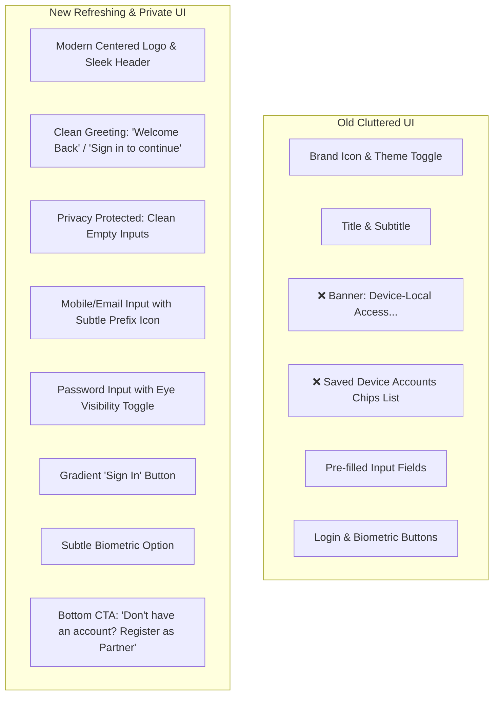

# CP CRM - Simple & Refreshing Login/Register UI Redesign Plan

## 1. Overview & Objectives
Based on your feedback, we are redesigning the Login and Registration interface to be **simple, refreshing, elegant, and privacy-focused**:
- **Privacy First**: Completely remove the public "Saved Device Accounts" chip list and any pre-filled user credentials from the Login screen so that other users' names, firms, or credentials are never exposed.
- **Clutter-Free & Minimalist**: Remove the "Device-Local Access" banner and unnecessary visual noise.
- **Refreshing & Modern Aesthetic**: A clean, spacious, premium layout with elegant branding, smooth rounded input fields, soft focus borders, modern typography, and a polished primary call-to-action.

---

## 2. Key Changes & UI Redesign

---

## 3. UI Specifications

### 3.1. Redesigned `LoginScreen`
- **Header**:
  - Centered or refined top bar with modern app icon, theme toggle, and a clean greeting:
    - **"Welcome Back"**
    - *"Sign in to your Channel Partner account"*
- **Form Inputs (Clean & Private)**:
  - **Phone Number / Email**: Crisp rounded input with a phone/mail icon and clear placeholder (`e.g. 9876543210 or name@firm.com`). Starts completely blank.
  - **Password**: Crisp rounded input with lock icon and an interactive show/hide toggle. Starts blank.
- **Actions**:
  - **Primary Sign In Button**: Full-width, modern rounded button with vibrant gradient and smooth touch feedback.
  - **Biometric Unlock Button**: Minimalist subtle outline button with fingerprint icon.
- **Bottom Navigation**:
  - Clean footer: *"Don't have an account? **Register as Partner**"*.

### 3.2. Redesigned `RegisterScreen`
- **Header**: Clean back arrow and title *"Create Partner Account"*.
- **Partner Type Segment**: Sleek 2-segment selector (*Agency / Firm* vs *Individual Realtor*).
- **Streamlined Fields**:
  - Authorized Contact Person
  - Agency Name (conditional if Agency is selected)
  - RERA Registration Number
  - Mobile Number & Email Address
  - Operating City
  - Password & Confirm Password
- **Action**: High-emphasis *"Register Account"* button.

---

## 4. Privacy & Data Handling (Behind the Scenes)
- **Local Persistence Remains Intact**: Registration and authentication continue to save and check credentials securely in the device's local database (`AuthStorageService`).
- **Zero Privacy Leakage**: The login screen will never reveal or enumerate who is registered on the device. Users must enter their own mobile number/email and password to authenticate.

---

## 5. File Modification Map
| File | Action | Description |
| :--- | :--- | :--- |
| `lib/features/auth/auth_screens.dart` | **Modify** | Implement the simple, refreshing UI layout for `LoginScreen` and `RegisterScreen`, eliminating banners and saved accounts chips. |

---

## 6. Verification Checklist
- [ ] Login screen is clean, modern, and uncluttered.
- [ ] No saved accounts chips or device-local banners are visible.
- [ ] Form fields start empty with clean placeholders.
- [ ] Logging in with registered credentials works seamlessly.
- [ ] Registering a new CP/SP works seamlessly and saves to device storage.
- [ ] Transitions between Login and Register are smooth.
