# CP CRM - Lead Details UI Polish, Real Docs Upload/Download & Project Brochure Implementation Plan

## 1. Executive Summary & Problem Analysis

Based on user feedback and the provided screenshots, this plan addresses four key UI and functional requirements across the CP CRM application:

1. **Lead Details UI Fix**:
   - **Problem**: In the Lead Details hero card, an amber/orange vertical accent strip (`width: 5, color: Color(0xFFF59E0B)`) runs along the left edge (visible in **Screenshot 1** adjacent to the `Lead Created` node).
   - **Solution**: Remove the left accent strip so the card features clean, symmetrical borders matching the rest of the application.
2. **Docs Section - Real File Upload & Re-upload Fix**:
   - **Problem**: In the "Upload Required Document" modal (**Screenshot 2**), tapping "Attach File" or Camera only toggles a hardcoded mock string (`sample_document_upload.pdf`). It does not trigger an actual device/browser file picker. Additionally, clicking "Replace Doc" (**Screenshot 3**) does not smoothly execute the replacement workflow.
   - **Solution**: Connect `DocumentPickerService` to the browser/device file picker (allowing PDF, JPG, PNG selection), display the real selected file name and size, and properly update document metadata and KYC state upon re-upload.
3. **Docs Section - Real File Download Fix**:
   - **Problem**: In the document card, Document Preview modal (**Screenshot 3**), and Payment Voucher modal, tapping "Download PDF" displays a `SnackBar` saying "Downloading...", but **no actual file is downloaded** to the user's browser or device.
   - **Solution**: Implement a cross-platform `FileDownloadService` (using HTML Blob anchor downloads on Web and local file/share fallback on mobile) that triggers an **actual file download** directly into Chrome's download manager.
4. **Project Section - Remove Commission Slab & Add Project Brochure**:
   - **Problem A**: The green banner titled `Commission Slab: 2.5% - 3.5%` (**Screenshot 4**) and the wallet icon in the AppBar are unwanted in the Project section.
   - **Solution A**: Completely remove the Commission Slab card and wallet AppBar action from `project_detail_screen.dart`.
   - **Problem B**: There is currently no option to upload or download project brochures within the project view.
   - **Solution B**: Introduce a dedicated **Project Brochure** module in `project_detail_screen.dart` with "+ Add Brochure", "Download PDF" (real browser download), "Share via WhatsApp", and "Replace Brochure" actions.

---

## 2. High-Level Architecture & Workflow Diagram

```mermaid
flowchart TD
    subgraph 1. Lead Details UI Polish
        L1[LeadDetailScreen Hero Card] --> L2[Remove Left Amber Accent Strip]
        L2 --> L3[Clean Symmetrical Border & Balanced Stepper]
    end

    subgraph 2. Docs Upload & Re-upload Flow
        D1[Tap 'Attach File' or 'Replace Doc'] --> D2[DocumentPickerService Native File Dialog]
        D2 --> D3[Extract Real File Name, Size & Bytes]
        D3 --> D4[Live File Preview in Modal Sheet]
        D4 --> D5[Submit for Verification]
        D5 --> D6[Update AppState & Recompute KYC Score]
    end

    subgraph 3. Real Browser Download Engine
        DW1[Tap 'Download PDF'] --> DW2[FileDownloadService]
        DW2 --> DW3{Platform Check}
        DW3 -->|Web / Chrome| DW4[Generate Blob URL & Click Anchor Tag]
        DW4 --> DW5[Chrome Downloads Real PDF File]
        DW3 -->|Mobile| DW6[Share / Save to Downloads Directory]
    end

    subgraph 4. Project Section Changes
        P1[ProjectDetailScreen] --> P2[REMOVE Commission Slab Banner & Wallet Icon]
        P1 --> P3[ADD Project Brochure Module]
        P3 --> P4[Upload Brochure Modal + PDF Download + WhatsApp Share]
        P4 --> P5[Sync with AppState.collaterals]
    end
```

---

## 3. Detailed Component Specifications

### 3.1. Lead Details Hero Card (`lib/features/leads/lead_detail_screen.dart`)
- **Target Location**: `_buildHeroCard` (around lines 825-845).
- **Changes**:
  1. Remove `Positioned(left: 0, top: 0, bottom: 0, child: Container(width: 5, decoration: ...))` which renders the amber line on the left.
  2. Maintain `clipBehavior: Clip.antiAlias` and `borderRadius: BorderRadius.circular(20)` with standard theme border (`AppColors.lightBorder` / `Color(0xFF222F43)`).
  3. Ensure symmetrical padding (`EdgeInsets.all(16)`) so that the avatar, text, and the 5-stage pipeline stepper (`Lead Created` → `Contacted` → `Site Visit` → `Negotiation` → `Booked`) align harmoniously without an offset strip.

---

### 3.2. Docs Section: Real File Picker & Re-upload (`lib/features/docs/docs_screen.dart` & `document_picker_service.dart`)
- **Target Location**: `DocumentPickerService` & `_openUploadDocModal` in `docs_screen.dart`.
- **Changes**:
  1. **Cross-Platform Document Picker**:
     - Enhance `DocumentPickerService` to pick both PDF documents and images on Web and Mobile.
     - On Web, open the browser file selector (`accept: '.pdf,.png,.jpg,.jpeg'`).
     - Retrieve real file metadata: `fileName` (e.g. `RERA_Certificate_2026.pdf`), `sizeBytes` formatted to `KB` or `MB`, and file bytes.
  2. **Upload Modal Sheet**:
     - Tapping "Attach File" triggers the real file dialog.
     - Upon selection, update the modal UI instantly with the actual file name, file size badge, and a green verification checkmark.
     - Camera button triggers `DocumentPickerService.pickDocumentFromCamera()` on devices that support camera capture.
  3. **Re-upload / Replace Workflow**:
     - When tapping "Replace Doc" from the Document Preview sheet:
       - Close the preview sheet safely.
       - Pre-populate the upload modal with existing document number, validity date, and document type.
       - Allow picking a new file from device.
       - On submission, call `widget.state.uploadOrUpdateDocument(...)`, update the status to `Under Review`, log the activity, and update the UI in place without losing scroll state.

---

### 3.3. Docs Section: Real Browser File Download Engine (`lib/core/services/file_download_service.dart`)
- **New Service**: Create `lib/core/services/file_download_service.dart` with conditional imports:
  - `file_download_service_web.dart` (for Chrome / Web):
    - Converts document data or generated PDF bytes into an `html.Blob(..., 'application/pdf')`.
    - Creates an `html.Url.createObjectUrlFromBlob(blob)`.
    - Creates an `html.AnchorElement(href: url)..setAttribute('download', fileName)..click()`.
    - Revokes the object URL cleanly to prevent memory leaks.
  - `file_download_service_stub.dart` (for native iOS / Android):
    - Fallback using `share_plus` or device file directory.
- **Download Targets**:
  1. **CP Required Docs**: Tapping download on any document card or in the preview modal downloads the actual document PDF (e.g. `rera_agent_cert_2024.pdf`, `cp_pan_card.pdf`, `gstin_certificate.pdf`).
  2. **Received Invoices & Vouchers**: Tapping "Download PDF" in the Disbursal Voucher modal downloads an official formatted receipt PDF (e.g. `DISB-BKG-8819.pdf`).

---

### 3.4. Project Section: Remove Commission Slab & Add Project Brochure (`lib/features/projects/project_detail_screen.dart`)
- **Changes in `project_detail_screen.dart`**:
  1. **Remove Commission Slab**:
     - Remove AppBar action: `IconButton(icon: const Icon(Icons.account_balance_wallet_outlined), tooltip: 'Commission Slabs & Invoices')`.
     - Remove `// Project Commission Slabs & Invoices Banner` container (lines 135-194).
     - Remove unused imports of `project_commission_table_screen.dart`.
  2. **Add Project Brochure Module**:
     - Positioned right below the "Distance & Connectivity Card".
     - **Card Layout**:
       - Left container: PDF icon with red/blue rounded container (`Icons.picture_as_pdf_rounded`).
       - Middle column:
         - Title: `${project.name} - Official Project Brochure`
         - Subtitle: `Floor Plans, Master Layout & Pricing • 4.8 MB`
       - Status badge: `Available to Share` or `PDF Ready`.
     - **Card Action Buttons**:
       - ⬇️ **Download PDF**: Triggers `FileDownloadService` to download the actual brochure PDF in the browser.
       - 💬 **Share WhatsApp**: Launches pre-filled WhatsApp message with project details and brochure link using `UrlActionService.openWhatsApp`.
       - 🔄 **Replace / Upload**: Opens `UploadBrochureModalSheet` to attach or update the brochure file from the user's computer.
  3. **Brochure Upload Modal (`UploadBrochureModalSheet`)**:
     - Allows picking a real PDF brochure via `DocumentPickerService`.
     - Input field for Brochure Title (default: `${project.name} Official Brochure`).
     - "Upload & Attach" button that saves the brochure to `AppState.collaterals` and links it to the project.
  4. **AppBar Shortcut**:
     - Add a brochure icon button in the AppBar actions next to the Cost Estimator for 1-tap brochure access.

---

## 4. Step-by-Step Implementation Roadmap

| Phase | Target File(s) | Key Actions |
| :--- | :--- | :--- |
| **Phase 1** | [`lead_detail_screen.dart`](file:///c:/Users/Y%20SRI%20VAISHNAVI/OneDrive/Desktop/CP%20CRM/lib/features/leads/lead_detail_screen.dart) | Remove left amber strip in `_buildHeroCard`; balance padding and border styling. |
| **Phase 2** | [`file_download_service.dart`](file:///c:/Users/Y%20SRI%20VAISHNAVI/OneDrive/Desktop/CP%20CRM/lib/core/services/file_download_service.dart) `file_download_service_web.dart` `file_download_service_stub.dart` | Implement cross-platform file download service with real Blob anchor click on Web. |
| **Phase 3** | [`document_picker_service.dart`](file:///c:/Users/Y%20SRI%20VAISHNAVI/OneDrive/Desktop/CP%20CRM/lib/core/services/document_picker_service.dart) | Enhance document picker to support real PDF & image selection with file metadata. |
| **Phase 4** | [`docs_screen.dart`](file:///c:/Users/Y%20SRI%20VAISHNAVI/OneDrive/Desktop/CP%20CRM/lib/features/docs/docs_screen.dart) | Wire real file selection, live file name/size display, real PDF downloads, and fix re-upload flow. |
| **Phase 5** | [`project_detail_screen.dart`](file:///c:/Users/Y%20SRI%20VAISHNAVI/OneDrive/Desktop/CP%20CRM/lib/features/projects/project_detail_screen.dart) | Remove Commission Slab banner and wallet action; build new Project Brochure module with upload & download. |
| **Phase 6** | Verification | Run `flutter analyze` and verify in the active Chrome instance. |

---

## 5. Verification Checklist

- [ ] **Lead Details**: Amber vertical bar is completely removed from the hero card; borders are clean and symmetrical.
- [ ] **Docs Upload**: Tapping "Attach File" opens the real file picker; selected file name and size reflect in the modal.
- [ ] **Docs Re-upload**: Tapping "Replace Doc" pre-fills existing document data and updates the document status and file properly.
- [ ] **Docs Download**: Tapping "Download PDF" triggers an actual browser file download in Chrome (file appears in Downloads).
- [ ] **Invoice Download**: Tapping "Download PDF" on an invoice voucher triggers an actual browser file download.
- [ ] **Project Section**: Green "Commission Slab: 2.5% - 3.5%" card and wallet AppBar action are completely removed.
- [ ] **Project Brochure**: "Project Brochure" card appears with "+ Add Brochure", "Download PDF", and "Share WhatsApp" options.
- [ ] **Quality Assurance**: `flutter analyze` exits with 0 issues.
